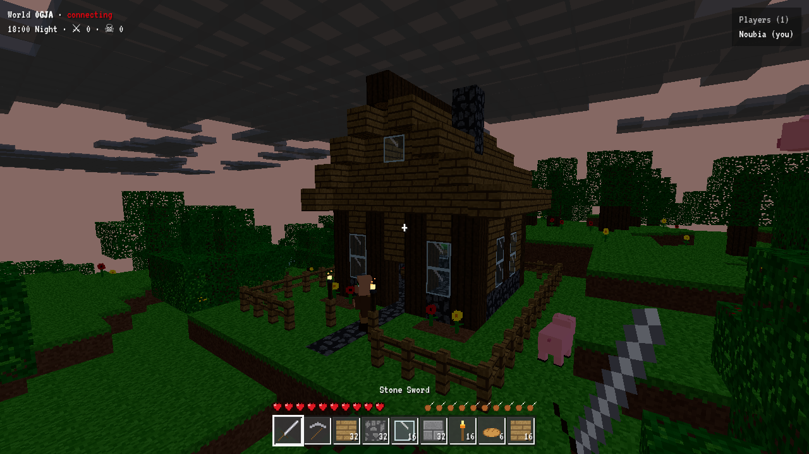
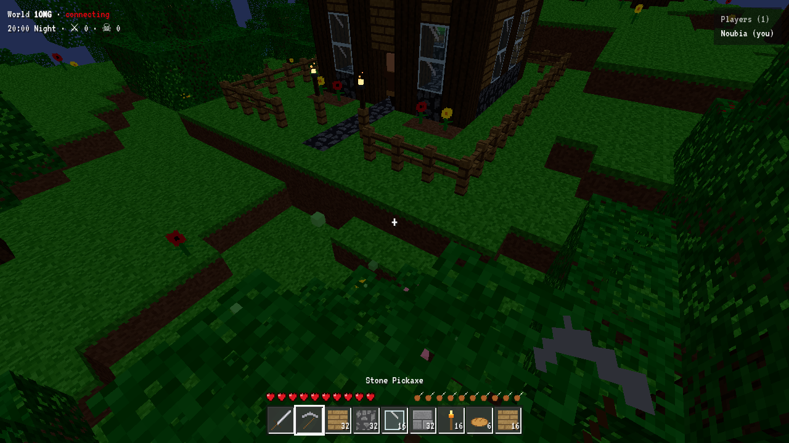
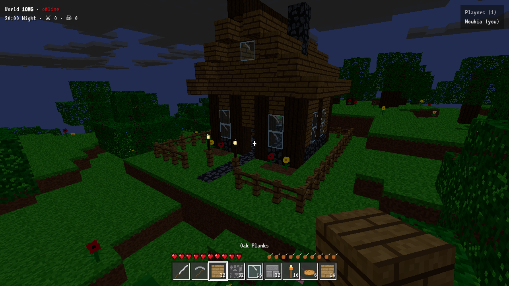
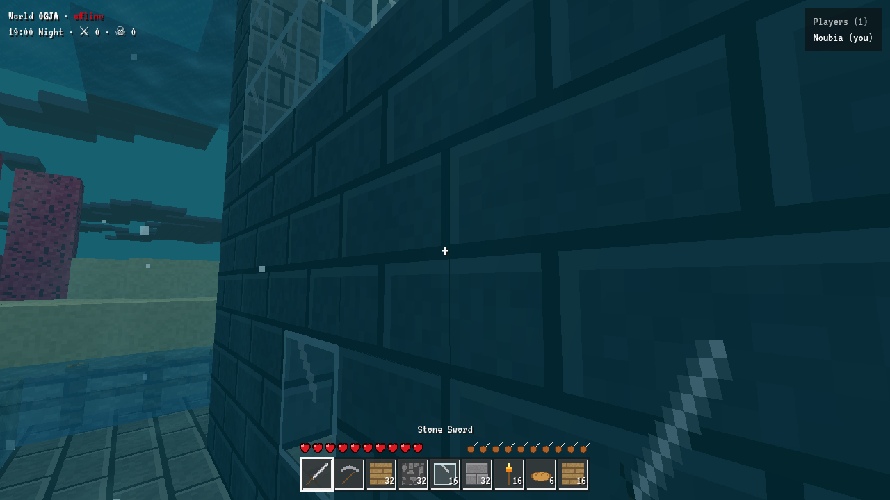
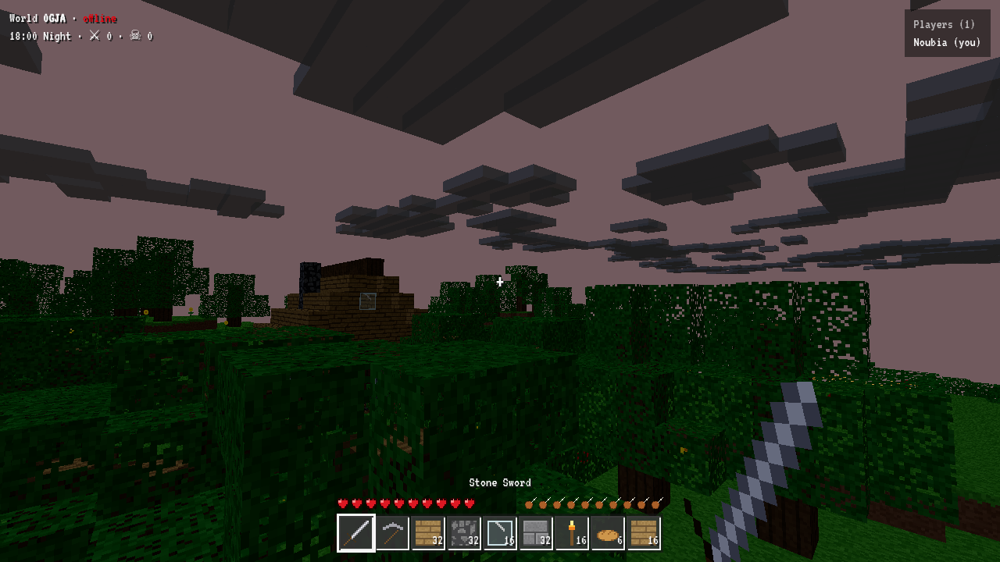
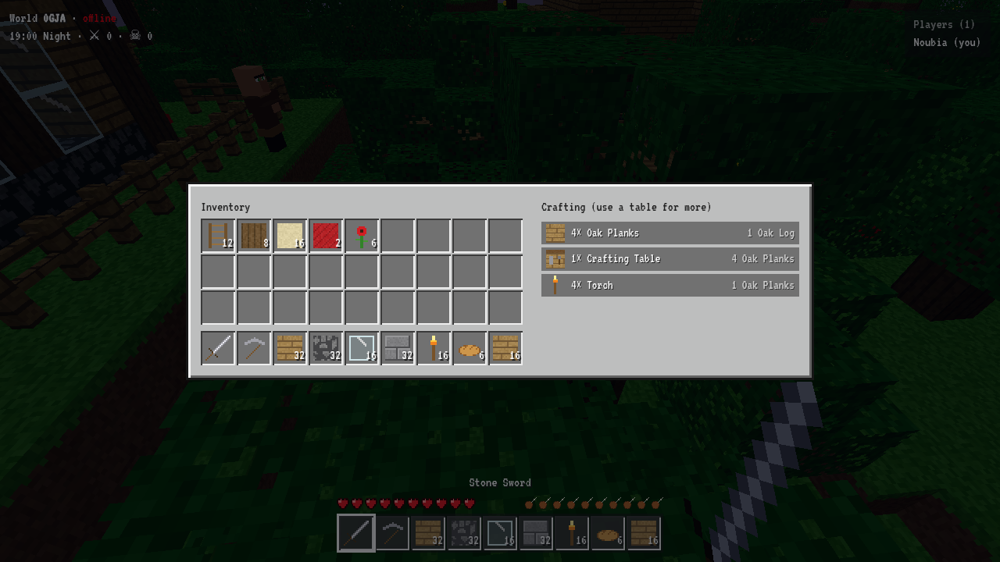
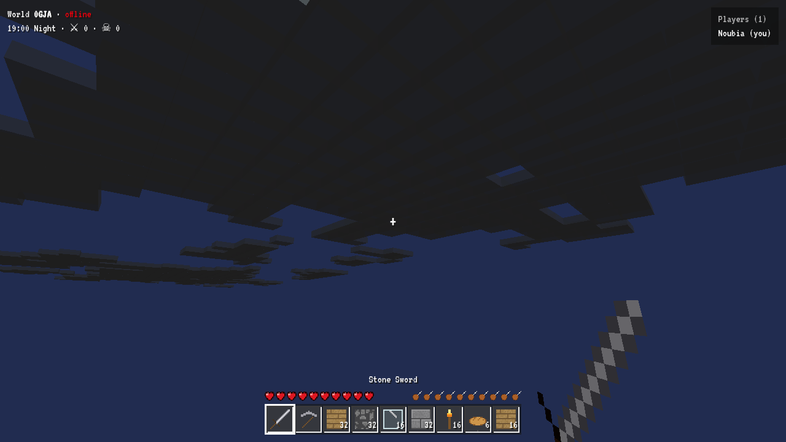

<div align="center">

# ⛏️ Blockfront

### A 3D voxel survival & PvP multiplayer game that runs right in your browser

**Created by [Noubia Bilomia Hance](https://github.com/12345noubia)**



</div>

---

## 🌍 About

**Blockfront** is a Minecraft-inspired voxel sandbox where friends join the same world, explore villages and an underwater observation tower, mine and build, and fight each other for loot — no download required.

## ✨ Features

| | |
|---|---|
| 🧱 **Mine & build** | Break blocks with left click (crack animation + particles), place them with right click |
| ⚔️ **Multiplayer PvP** | Join a room with a world code, see other players move in real time, fight and steal their dropped loot |
| 💬 **Live chat** | Talk with everyone in your world |
| 🏡 **Villages** | Rustic log-and-cobblestone cabins with gable roofs, chimneys, fences, flowerbeds and torches |
| 🌊 **Underwater world** | Glass & stone-brick observation tower, caustic lighting, light rays, bubbles and schools of tropical fish |
| 🐷 **Mobs** | Villagers with folded arms, pigs, and creepers that hiss and explode |
| 🌗 **Day / night cycle** | Moving sun and moon with boxy clouds — sleep in a bed to skip the night |
| 🎒 **Survival** | Hotbar, inventory, crafting, chests, health, hunger and respawn |
| 🏊 **Swimming** | Swim up with Space, sink when idle, splashes and muffled underwater sound |

## 📸 Screenshots

<table>
<tr>
<td><p align="center"><b>Mining with a stone pickaxe</b></p></td>
<td><p align="center"><b>Building with oak planks</b></p></td>
</tr>
<tr>
<td><p align="center"><b>The underwater observation tower</b></p></td>
<td><p align="center"><b>Exploring the world</b></p></td>
</tr>
<tr>
<td><p align="center"><b>Inventory & crafting</b></p></td>
<td><p align="center"><b>Night sky with boxy clouds</b></p></td>
</tr>
</table>

## 🎮 Controls

| Key | Action |
|---|---|
| `W A S D` | Move |
| `Mouse` | Look around |
| `Space` | Jump / swim up / climb ladders |
| `Left click` | Mine / attack |
| `Right click` | Place block / use bed, chest, crafting table |
| `1`–`9` | Select hotbar slot |
| `E` | Inventory & crafting |
| `T` / `Enter` | Open chat |
| `Esc` | Pause |

## 🛠️ Tech Stack

- **React 19** + **TanStack Start** + **TypeScript**
- **Three.js** & **React Three Fiber** for 3D rendering
- **Realtime multiplayer** over Lovable Cloud broadcast channels
- **Tailwind CSS** for the interface
- Procedural, deterministic world generation and generated textures & sound

## 🚀 Run locally

```sh
git clone https://github.com/12345noubia/<repository-name>.git
cd <repository-name>
npm install
npm run dev
```

Then open the local address shown in your terminal, enter a name and a world code, and share the code with friends.

## 👤 Author

**Noubia Bilomia Hance** — creator & designer of Blockfront
GitHub: [@12345noubia](https://github.com/12345noubia)

<div align="center">

Made with ❤️ by Noubia Bilomia Hance

</div>
